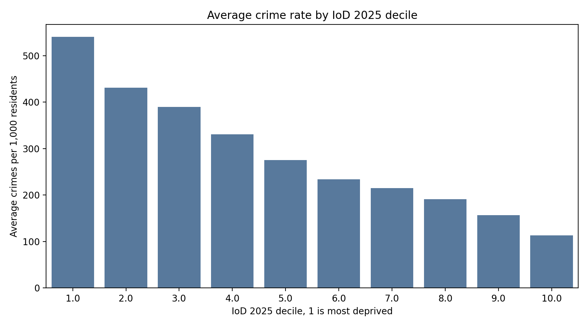
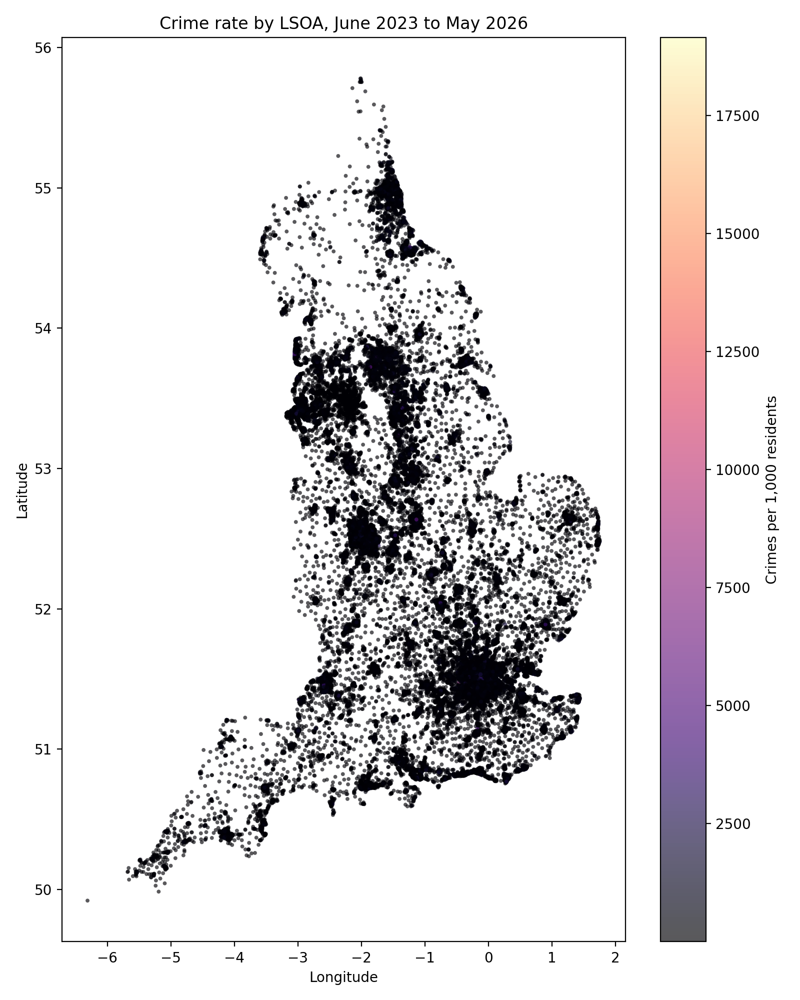

# England Crime and Deprivation Analysis

UWE Bristol, Big Data module coursework. The code in this repository is my own.

GitHub: [KNHNF/england-crime-deprivation-analysis](https://github.com/KNHNF/england-crime-deprivation-analysis) (renamed from the working repo name `bigdata-crime-deprivation-spark`).

## What this is

A distributed Big Data pipeline that tests whether area deprivation is associated with crime across England, and whether deprivation features can predict crime levels at small-area (LSOA) level.

This is a national-scale rebuild of an earlier prototype (`bigdata-crime-deprivation`), which used pre-aggregated crime tables of about 25,000 rows and was marked down for not being genuinely big data. That prototype is kept for reference and is not reused here. This version processes the full street-level police.uk archive (June 2023 to May 2026, 17.8 million individual crime records) with Apache Spark, stores processed output in MongoDB, and trains a machine learning model to predict crime hotspots from deprivation features.

## What I built

I built the Spark pipeline end to end, loaded the output into MongoDB, and wrote the query behind the headline chart. Two findings are mine specifically:

- Deprivation and crime rate move together across all ten IoD deciles, no exceptions, a 4.8x gap between the most and least deprived areas.
- Greater Manchester's crime data is missing from the archive entirely, not genuinely low. I confirmed this during EDA, then corrected it two independent ways, nearest-neighbour matching against similar areas and a random forest model, both landing near the same 200x gap (`src/estimate_gm_crime_rate.py`, `docs/16_gm_crime_rate_estimate.md`).



Average crimes per 1,000 residents by IoD 2025 deprivation decile (1 is most deprived), June 2023 to May 2026. The rate falls at every step, from about 540 to about 113.

## Why the scale matters

The full street-level archive is the point, not an optional extra. It is what justifies Spark over pandas, and it is the direct answer to the feedback on the prototype. Each crime record carries an LSOA code, so it joins straight to the Index of Multiple Deprivation at LSOA level. No manual police-force-to-district lookup is needed this time.

## Pipeline

```
Raw police.uk street CSVs (17.8M rows, 1,563 files)
   -> Apache Spark (clean, join with IoD 2025, aggregate to LSOA)
   -> MongoDB (32,944 processed area records)
   -> machine learning (hotspot classification: logistic regression and random forest)
   -> presentation
```

I did not build a dashboard. The queries and the MongoDB schema are documented in `docs/04_mongodb.md`, and a dashboard would have added scope without adding to the analysis.

## How to read this repo

Start with `docs/01_project_overview.md` for the research question and the whole pipeline in one page. Each `docs/` file after that covers one component: what it does, why that approach, problems hit, and outcome. You can present your section from the docs without reading the code.

```
docs/
  01_project_overview.md   research question and the whole pipeline in one page
  02_datasets.md           the two datasets, the join key, how to download
  03_spark_pipeline.md     what Spark does and why Spark, including real bugs hit and fixed
  04_mongodb.md            document schema, indexes, queries
  05_machine_learning.md   the ML task, model, metrics
  07_results.md            findings, each with an explanation
  08_limitations.md        what the data and method cannot tell us
  10_eda_and_build_log.md  EDA plan, build decisions, and issues hit
  16_gm_crime_rate_estimate.md  how the missing Greater Manchester rate was estimated, two ways
```

## Repository layout

```
.
├── README.md
├── requirements.txt
├── docs/                 one short file per component (read these)
├── src/                  pipeline code (see src/README.md)
├── data/                 raw and processed data, gitignored, download manually
└── figures/              charts and maps
```

## Quickstart

```bash
python -m venv venv
venv\Scripts\activate
pip install -r requirements.txt
```

PySpark needs Java 11 or 17. Java 25 fails locally with `getSubject is not supported`, so set `JAVA_HOME` to a Java 17 install before running the full pipeline. On Windows you may also see a `winutils.exe` warning, that one is harmless, the Java version error is the one that blocks the run.

Copy `.env.example` to `.env` and fill in the MongoDB URI. The current local police.uk extract is `data/Crime Data LSOA (june 2023 - may 2026)`, and the IoD file is already named in `.env.example`.

Run the Spark pipeline:

```bash
python src/spark_pipeline.py
```

Create the presentation maps, charts, and model outputs:

```bash
python src/visualise.py
python src/train_model.py
```

Load the Spark Parquet output into MongoDB:

```bash
python src/load_mongo.py
python src/load_monthly_trend_mongo.py
```

The `data/` folder is gitignored, so nothing large is committed.

## Real numbers from the full run

17,837,130 raw crime rows read, 16,249,125 after cleaning and filtering to English LSOAs, aggregated to 32,944 LSOA rows (essentially all English LSOAs), 74 unmatched against the IoD table (0.22%). Figures are 3-year cumulative totals, June 2023 to May 2026, not monthly rates. Full detail and the two real bugs found along the way are in `docs/03_spark_pipeline.md`.



Crime rate by small area (LSOA). The dark patch is Greater Manchester, which has no crime data in the archive. It is missing, not low, so I estimated it two ways and flagged it (see above).

Hotspot classification: a hotspot is an area in the top quarter of crimes per 1,000 residents (above 335 per 1,000). Fifteen deprivation and population features, 32,870 areas.

| Model | Accuracy | Hotspot precision | Hotspot recall | Hotspot F1 |
|---|---|---|---|---|
| Logistic regression | 0.804 | 0.578 | 0.798 | 0.670 |
| Random forest | 0.820 | 0.700 | 0.487 | 0.575 |

The random forest is more accurate overall and more precise, but it finds fewer hotspots. The logistic regression finds about 80% of them and raises more false alarms.

## Tools used

- Python 3.11: project scripts.
- Java 17: required for PySpark on this project.
- Apache Spark, through PySpark: reads and aggregates the national police.uk CSV archive.
- MongoDB Atlas: stores the processed LSOA documents (`Crime_England_Deprivation`, 32,944 documents) and monthly national totals (`monthly_crime_trend`, 36 documents).
- MongoDB Compass: checking imported documents and indexes, and screenshotting real query output for the presentation.
- scikit-learn: hotspot classification (logistic regression and random forest).
- Matplotlib and Seaborn: charts for the presentation.
