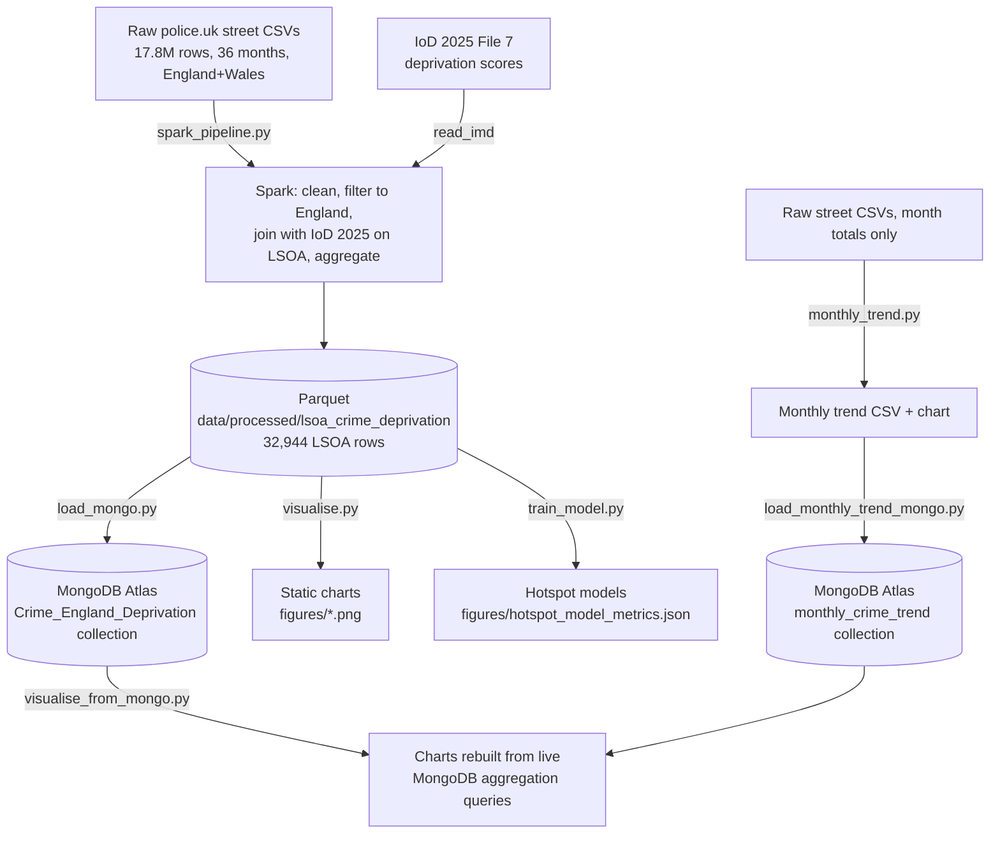

# 00 Run Guide

Start here. This is the one file that answers "what do I actually type" and "what has already happened." Everything else in `docs/` is detail and reasoning, this is the map.

## Pipeline, visually



## Status right now

| Step | Script | Status |
|---|---|---|
| Full Spark run | `src/spark_pipeline.py` | Done. 17,837,130 raw rows -> 32,944 LSOA rows, 74 unmatched (0.22%) |
| Static charts from Parquet | `src/visualise.py` | Done, 7 charts in `figures/` |
| Hotspot model training | `src/train_model.py` | Done, real metrics in `docs/05_machine_learning.md` |
| Monthly trend | `src/monthly_trend.py` | Done, `figures/monthly_crime_trend.png` |
| MongoDB load (main data) | `src/load_mongo.py` | Done, loaded to Atlas directly |
| MongoDB load (monthly trend) | `src/load_monthly_trend_mongo.py` | Done |
| Charts from MongoDB queries | `src/visualise_from_mongo.py` | Done, 3 `_mongo` charts in `figures/` |
| Feature importance chart | `src/train_model.py` (now included) | Done, `figures/random_forest_feature_importance.png` |
| Interactive deprivation map | `src/visualise.py` (now included) | Done, `figures/deprivation_heatmap.html` |
| Local authority ranking | `src/visualise.py` (now included) | Done, `figures/local_authority_ranking.png` (Greater Manchester excluded, no data, see `docs/08`) |
| Dashboard | — | Dropped, not required by the brief |
| Slide deck | — | Not started |

## Run everything in order (if starting from scratch)

All commands from the repo root, with the Python venv active and `.env` filled in (copy `.env.example` if you haven't).

```bash
# 1. Process the full archive with Spark (20-60 min, needs Java 17 + winutils.exe on Windows)
python src/spark_pipeline.py

# 2. Build the static charts from that output
python src/visualise.py

# 3. Train the hotspot models
python src/train_model.py

# 4. Build the monthly national trend chart (reads raw CSVs directly, no Spark)
python src/monthly_trend.py

# 5. Load the main processed data into MongoDB Atlas
python src/load_mongo.py

# 6. Load the monthly trend data into MongoDB Atlas too
python src/load_monthly_trend_mongo.py

# 7. Rebuild the decile/category/trend charts from live MongoDB queries
python src/visualise_from_mongo.py
```

Steps 1-4 only need to be rerun if the raw data changes. Steps 5-7 only need your `.env`'s `MONGO_URI` pointing at Atlas and your current IP allowlisted in Atlas Network Access.

## How to run the MongoDB code specifically

You already did step 5 (the main load) directly against Atlas. Two things are still outstanding:

**Step 6, load the monthly trend collection:**

```bash
python src/load_monthly_trend_mongo.py
```

This reads `data/processed/monthly_crime_counts.csv` (already generated by `monthly_trend.py`) and writes 36 documents into a new `monthly_crime_trend` collection, one per month, indexed on `month`. Takes a few seconds, it's a tiny collection.

**Step 7, rebuild charts from live queries instead of the local Parquet file:**

```bash
python src/visualise_from_mongo.py
```

This connects to Atlas and runs three real aggregation queries:

- Average crime rate grouped by IMD decile (`$group` + `$avg`)
- Total crimes per category, unwound from the nested `crimes_by_category` field (`$objectToArray` + `$unwind` + `$group`)
- The monthly trend, read straight from the new collection above

It writes three PNGs into `figures/` with `_mongo` in the filename, so they sit alongside the Parquet-sourced versions without overwriting them. These `_mongo` charts and their queries are what to reference on the "how we queried the data" slide, since they're real queries against your actual database, not a description of one.

Both scripts read `MONGO_URI`, `MONGO_DB`, and `MONGO_COLLECTION` from `.env`, same as `load_mongo.py` already does, no new configuration needed if that file is already set up.

## What was actually done, short version

Started from a prototype that got marked down for not being genuine big data (25k pre-aggregated rows). Rebuilt around the full national police.uk street-level archive (17.8M+ individual crime records, 36 months, June 2023 to May 2026), processed with Spark, joined to the 2025 Indices of Deprivation at LSOA level.

Two real bugs were found and fixed during that build: police.uk's separate outcomes-only files were contaminating the crime read (fixed with a filename filter), and four Welsh police forces were causing an 86% join-failure rate against the England-only deprivation table (fixed by scoping the analysis to England, down to 0.22% unmatched).

Real findings, each with a "why," not just a "what": deprivation and crime rate are strongly linked (4.8x gap between the most and least deprived deciles), the handful of extreme outlier LSOAs are commercial/nightlife/transport-hub areas with low resident populations rather than genuinely dangerous places to live, crime is seasonal (summer 15-20% above winter, consistent with routine activity theory), violence and sexual offences dominate the category breakdown (34.4%), and the hotspot classifiers show a real precision/recall trade-off rather than one model cleanly winning. Full detail with numbers in `docs/07_results.md`, full build history in `docs/10_eda_and_build_log.md`.
